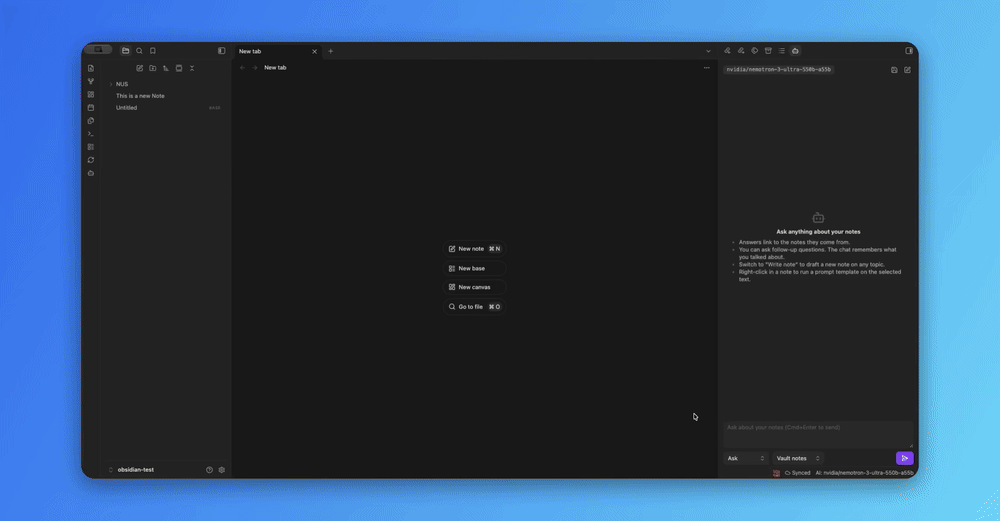

# <div align="center">Vault LLM Assistant for Obsidian</div>

<div align="center">
Chat with your Obsidian notes using AI. Get answers that link back to your notes, write new notes, and clean up your writing with prompt templates. Works with OpenAI, Claude, Gemini, Groq, NVIDIA NIM, OpenRouter, local models and more.
</div>

<br />

<div align="center">
  <a href="https://github.com/brianstm/obsidian-vault-llm-assistant/releases">
    
  </a>
</div>

<br />



## Features

- **Chat with your vault.** Ask a question in the sidebar and get an answer with links to the notes it used. You can keep asking follow-up questions in the same chat.
- **Finds the right notes for you.** It looks for the notes that best match your question and only sends those, so it works fine with big vaults. You can also stick to the note you have open, or leave your notes out.
- **Writes notes.** Switch to "Write note" and give it a topic. It drafts a full note and can pull from what you already have.
- **Prompt templates.** Summarize, improve writing, fix spelling and grammar, keep writing, pull out action items, suggest tags, explain or translate. You can make your own too.
- **Lots of providers.** OpenAI, Claude, Gemini, Groq, NVIDIA NIM, OpenRouter, Mistral, DeepSeek, xAI, LM Studio, Ollama, or any server that works with the OpenAI API.
- **Always up to date models.** The model list comes straight from your provider, so new models show up without waiting for a plugin update.
- **Your key stays safe.** API keys are kept in Obsidian's secret storage, not in the plugin's data file.
- Copy an answer, drop it into your note at the cursor, turn it into a new note, or save the whole chat.
- Can also send images from your notes to models that support them.

See the [Changelog](CHANGELOG.md) for what changed in each version.

## Installation

### From Community plugins

1. Open Settings → Community plugins in Obsidian, or use this link: [https://obsidian.md/plugins?id=vault-llm-assistant](https://obsidian.md/plugins?id=vault-llm-assistant)
2. Turn off Restricted mode if it's on
3. Select "Browse" and search for "Vault LLM Assistant"
4. Install it and turn it on

You need Obsidian 1.11.4 or newer.

### Manual install

1. Download `main.js`, `manifest.json` and `styles.css` from the latest [release](https://github.com/brianstm/obsidian-vault-llm-assistant/releases/)
2. Put them in `.obsidian/plugins/vault-llm-assistant/` inside your vault
3. Restart Obsidian and turn the plugin on in Settings → Community plugins

## Getting started

1. Open the plugin settings and pick a **provider**.
2. Add your **API key**. Click the key field to make a new secret, or pick one you've already saved in Obsidian.
3. The plugin loads the models your key can use. Pick one from the **Model** list.
4. Hit **Test** to make sure it all works.
5. Open the chat from the ribbon icon, the status bar, or the "Open chat" command.

## Providers

| Provider | Where to get a key | Good to know |
| --- | --- | --- |
| OpenAI | [platform.openai.com](https://platform.openai.com/api-keys) | GPT and o-series models, Pro models included |
| Anthropic Claude | [platform.claude.com](https://platform.claude.com/settings/keys) | All current Claude models |
| Google Gemini | [aistudio.google.com](https://aistudio.google.com/apikey) | All Gemini models your key can use |
| Groq | [console.groq.com](https://console.groq.com/keys) | Open models that run really fast |
| NVIDIA NIM | [build.nvidia.com](https://build.nvidia.com/settings/api-keys) | Use the hosted models, or point the base URL at your own NIM |
| OpenRouter | [openrouter.ai](https://openrouter.ai/settings/keys) | Hundreds of models with one key |
| Mistral AI | [console.mistral.ai](https://console.mistral.ai/api-keys) | Mistral, Magistral and Codestral |
| DeepSeek | [platform.deepseek.com](https://platform.deepseek.com/api_keys) | DeepSeek Chat and Reasoner |
| xAI Grok | [console.x.ai](https://console.x.ai) | Grok models |
| LM Studio | no key needed | Runs on your computer. Turn on the local server in LM Studio |
| Ollama | no key needed | Runs on your computer. Pull a model first, like `ollama pull llama3.2` |
| Custom | optional | Any server that works with the OpenAI chat API, like vLLM, LiteLLM, Together or Fireworks |

Every provider has a **Base URL** setting, so you can send requests through a proxy or your own server too.

The model list is loaded from the provider when you open the settings, and refreshed once a day. If a brand new model is missing, hit the refresh button next to the list. You can also pick "Other" and type any model name.

## Using it

### Chat

Type your question and press **Cmd+Enter** (Ctrl+Enter on Windows and Linux) to send it. Plain Enter adds a new line.

Under the text box you can pick:

- **Mode.** "Ask" answers questions. "Write note" drafts a new note on a topic.
- **Notes.** "Vault notes" finds the notes that match your question. "Current note" uses the note you have open (and the notes linked to it, if you want). "No notes" just asks the model.

Each answer shows which notes it used. Under the answer you can copy it, put it in your note at the cursor, turn it into a new note, or try again. The buttons at the top start a new chat or save the whole chat as a note.

### Prompt templates

Select some text in a note, right-click, and choose **Run AI prompt template**. You can also use the command palette. Every template gets its own command, so you can give your favorites a hotkey.

Templates can use these placeholders:

| Placeholder | Gets replaced with |
| --- | --- |
| `{{selection}}` | The text you selected, or the whole note if nothing is selected |
| `{{note}}` | The whole note |
| `{{before}}` | Everything before the cursor |
| `{{title}}` | The note's title |

A template can replace your selection, add its result below it, answer in the chat, or make a new note. You can edit, add and delete templates in the settings.

### Commands

- Open chat
- Start a new chat
- Ask a question about your vault
- Ask a question about the current note
- Create a note about a topic
- Run a prompt template on the selection or note
- Prompt: *template name* (one for each template)

## Settings

- **Model provider:** the provider, your API key, the base URL, the model, and a connection test.
- **Responses:** max tokens, temperature, reasoning effort, and custom instructions that get added to every request.
- **Vault context:** which notes to use by default, how they're picked, how much text to send, how many notes to send, linked notes, images, and which folders to use or skip.
- **New notes:** where new notes go, whether the model names them, and the default chat mode.
- **Prompt templates:** edit, add or bring back the default templates.

## Privacy and network use

The plugin only talks to the internet when you use it:

- When you ask a question, write a note or run a template, your prompt and the notes it picked (plus images, if you turned that on) go to **the provider you chose**, at the base URL in the settings. That provider's privacy terms apply. With LM Studio, Ollama or a local server, nothing leaves your computer.
- Loading the model list and the "Test" button talk to the same provider.
- It reads the notes in your vault to find the right ones, and only creates notes when you ask it to. It only writes to your clipboard when you hit copy.
- No tracking, and no other servers.

Want to keep a folder private? Add it to "Never read these folders" in the settings.

## Troubleshooting

- **Key errors:** check your API key in the settings, then hit "Test".
- **Model not found or missing:** hit the refresh button next to the model list, or type the exact model name.
- **Answer cut off or empty:** raise "Max tokens". Thinking models use some tokens to think before they answer.
- **Request too big:** lower "Maximum context size" or "Maximum notes".
- **LM Studio or Ollama won't connect:** make sure the app is running and the base URL is right. LM Studio uses `http://localhost:1234/v1` and Ollama uses `http://localhost:11434`.
- For more detail, open the developer console (Cmd+Option+I on macOS, Ctrl+Shift+I elsewhere).

## Development

See [CONTRIBUTING.md](CONTRIBUTING.md).

```bash
git clone https://github.com/brianstm/obsidian-vault-llm-assistant.git
cd obsidian-vault-llm-assistant
npm install
npm run dev
```

## License

This project is licensed under the [MIT License](LICENSE).

## Credits

- Developed by [Brians Tjipto](https://github.com/brianstm)
- Website: [brianstjipto.xyz](https://www.brianstjipto.xyz/)

---

If you find this plugin helpful, please consider starring the [GitHub repository](https://github.com/brianstm/obsidian-vault-llm-assistant)!
